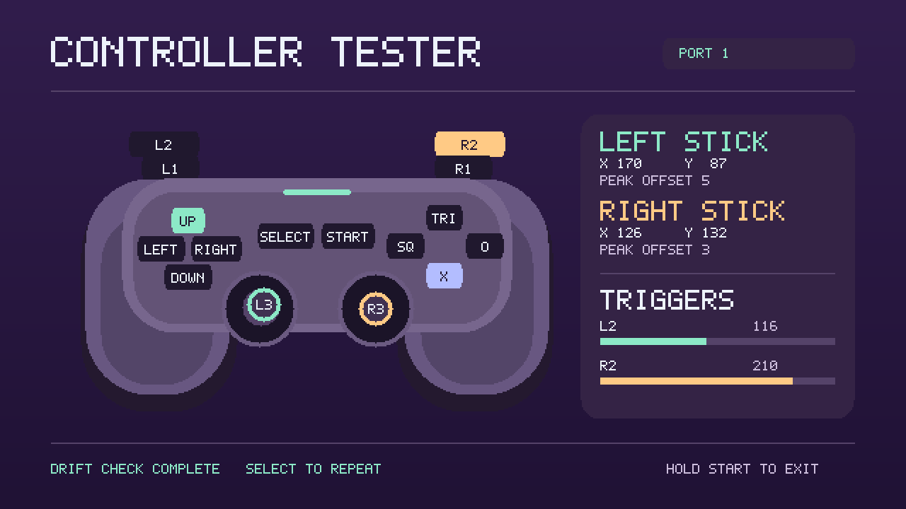

# Controller Tester for PS3

Version 1.1 shows the first connected standard controller on a plum gradient dashboard. The on-screen sticks move with the physical sticks, and controls light up in their matching positions. The side panel shows raw stick coordinates (0–255) and separate L2 and R2 bars. On controllers that report pressure, the bars use the reported values. Other controllers show pressed or released.

Press **Select** and leave both sticks untouched for three seconds to check drift. Each stick reports its largest deviation from 128 on either axis, measured in raw controller units. Try the check again after moving and releasing the sticks if you want to compare where they settle. Hold **Start** for one second to exit.

## Install

Download [Controller_Tester.pkg](../downloads/Controller_Tester.pkg) and copy it to a FAT32 USB drive. Install it through **Game → Package Manager → Install Package Files → Standard**. Open **Controller Tester** from the Game column. It has a separate title ID from PS3 Stats.

The package was cross-compiled with PS3DEV and PSL1GHT. The dashboard preview uses sample inputs. Installation, analog pressure, and controller behavior still need testing on physical CFW hardware.

## Build

Set `PS3DEV` and `PSL1GHT` to your installed toolchain and SDK paths, then run `make -C ps3-controller-tester` from the repository root. The finalized CFW package is `ps3-controller-tester/Controller_Tester.gnpdrm.pkg`.
